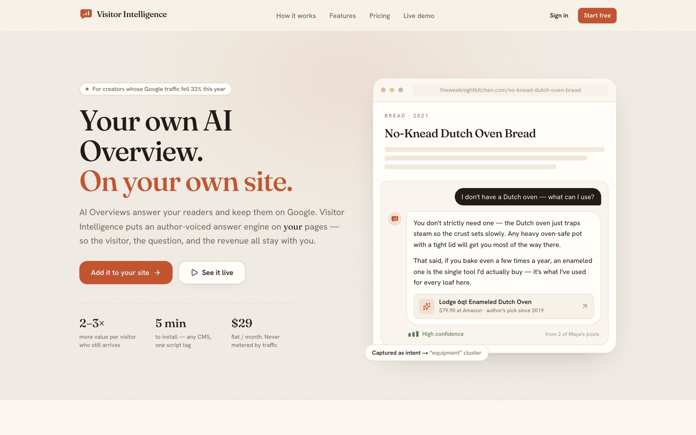
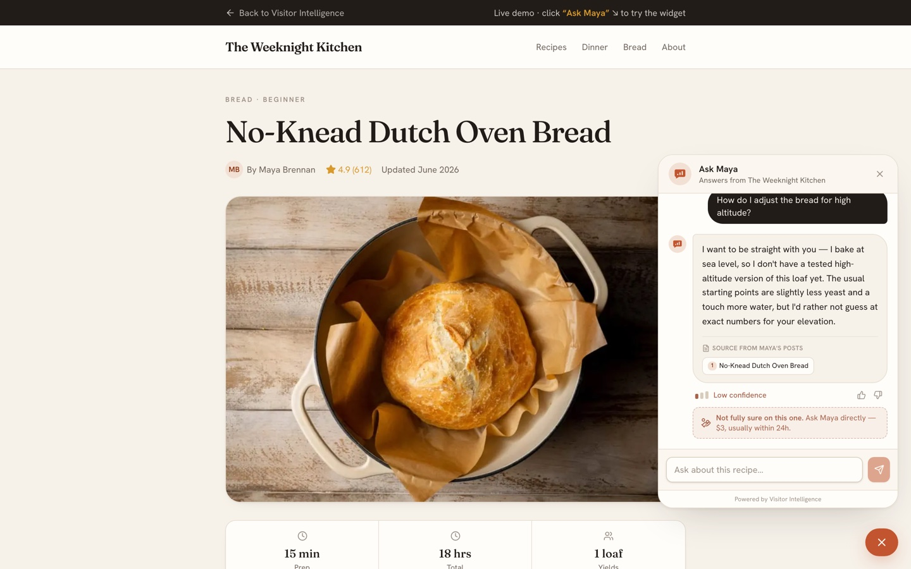
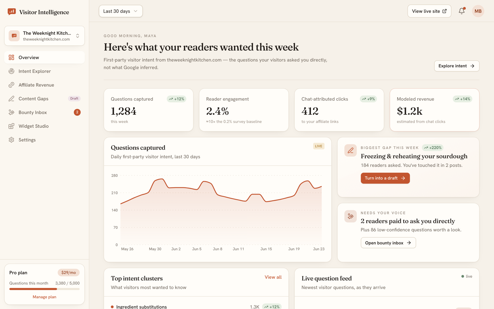
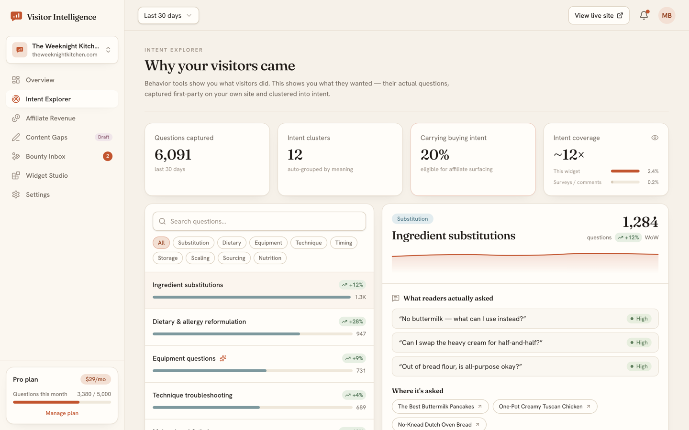
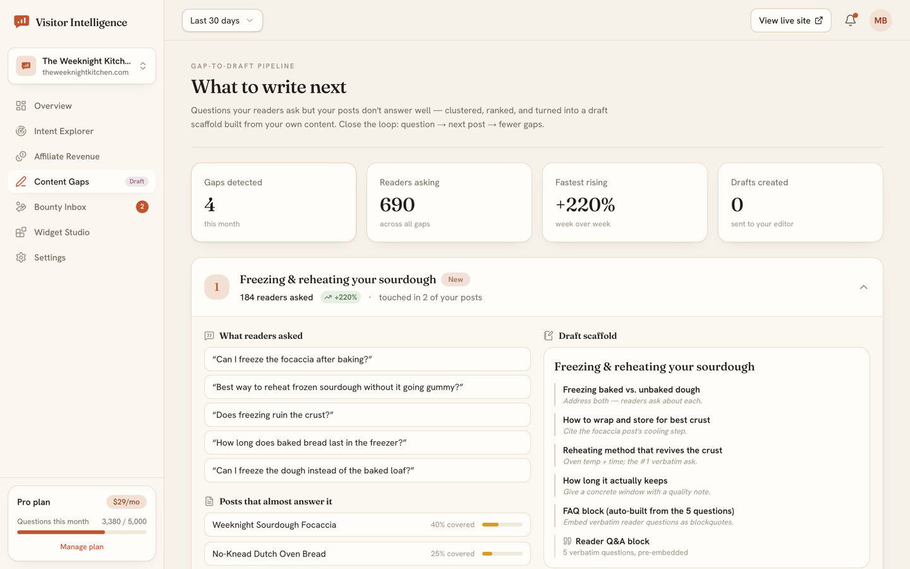
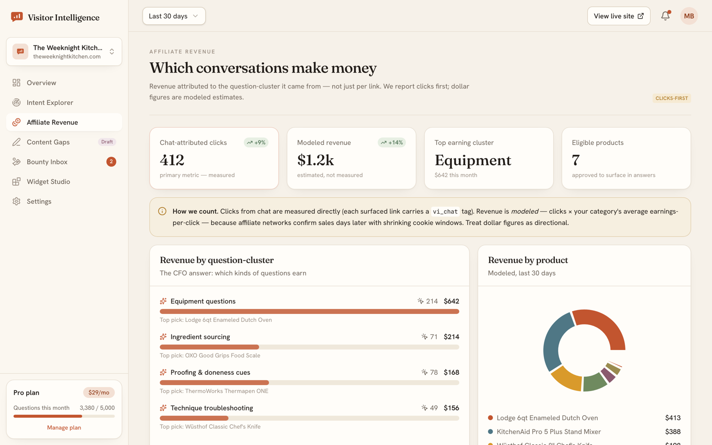
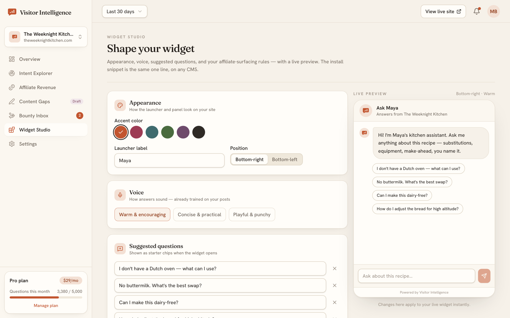
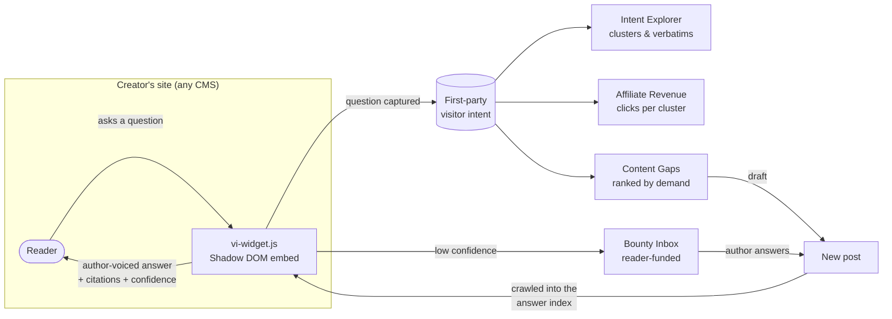

# Visitor Intelligence

**A proof-of-concept prototype: turning the questions readers ask on a creator's site into first-party intent, revenue, and content direction.**

[](https://github.com/kamlau024/VisitorIntelligence/actions/workflows/ci.yml)
[](LICENSE)


**[Clickable prototype →](https://visitorintelligence.vercel.app)** · [Try the widget](https://visitorintelligence.vercel.app/demo) · [Open the dashboard](https://visitorintelligence.vercel.app/dashboard)

> [!IMPORTANT]
> **This is a proof-of-concept prototype, not a working application.** It is a
> high-fidelity, fully clickable mockup built to explore and validate the product idea
> after ~3 months of research. Every screen and state is real UI, but:
>
> - **All data is mock data:** a typed dataset for a fictional food blog, *The Weeknight Kitchen*.
> - **The widget's answers are canned,** matched by keyword. There is no AI or LLM behind them.
> - **Nothing is connected:** no site crawling, accounts, payments, or affiliate tracking.
>   Actions like verifying an install, paying a bounty, or sending a draft to WordPress
>   only simulate the outcome.
>
> The code is structured so a real backend could slot in behind the existing types.



---

## The problem

Google's AI Overviews now answer recipe and how-to questions directly on the results
page, so independent creators lose the visit, the affiliate click, and any signal about
what their audience actually wanted.

Visitor Intelligence is a concept for putting an **author-voiced answer engine on the
creator's own pages**. Every question a reader asks would become *first-party visitor
intent*: clustered, tied to affiliate revenue, and turned into a ranked list of posts the
creator should write next. This prototype shows what that product would look like and how
it would behave.

## What the prototype shows

| Surface | Route | What it shows |
|---|---|---|
| Marketing site | [`/`](https://visitorintelligence.vercel.app) · [`/pricing`](https://visitorintelligence.vercel.app/pricing) | Positioning, closed-loop explainer, tiered pricing |
| Onboarding | [`/get-started`](https://visitorintelligence.vercel.app/get-started) | CMS-agnostic install: connect → crawl → approve affiliate inventory → tune voice → paste snippet → verify |
| Widget in context | [`/demo`](https://visitorintelligence.vercel.app/demo) | Author-voiced answers, source citations, confidence meter, "author's pick" affiliate chip, paid "ask the author" bounty |
| Overview | [`/dashboard`](https://visitorintelligence.vercel.app/dashboard) | Intent volume, engagement, modeled revenue, biggest gap, live question feed (`?state=empty` for the empty state) |
| Intent Explorer | [`/dashboard/intent`](https://visitorintelligence.vercel.app/dashboard/intent) | Question clusters with verbatim questions and per-page intent: the *why*, not just the *what* |
| Affiliate Revenue | [`/dashboard/revenue`](https://visitorintelligence.vercel.app/dashboard/revenue) | Clicks and modeled revenue per question cluster, plus "could have linked" opportunities |
| Content Gaps | [`/dashboard/content-gaps`](https://visitorintelligence.vercel.app/dashboard/content-gaps) | Ranked gaps → draft scaffold or full article → send to WordPress / Notion / Markdown |
| Bounty Inbox | [`/dashboard/bounties`](https://visitorintelligence.vercel.app/dashboard/bounties) | Low-confidence answers that readers paid to escalate to the author |
| Widget Studio | [`/dashboard/widget`](https://visitorintelligence.vercel.app/dashboard/widget) | Appearance, voice, suggested questions, affiliate rules, live preview, embed snippet |
| Embed proof | [`/embed-test.html`](https://visitorintelligence.vercel.app/embed-test.html) | A plain HTML page with unrelated styles that loads the widget from one `<script>` tag |

<table>
  <tr>
    <td></td>
    <td></td>
  </tr>
  <tr>
    <td align="center"><sub>The widget admits low confidence and offers a paid escalation</sub></td>
    <td align="center"><sub>Dashboard overview</sub></td>
  </tr>
  <tr>
    <td></td>
    <td></td>
  </tr>
  <tr>
    <td align="center"><sub>Intent Explorer</sub></td>
    <td align="center"><sub>Content Gaps → drafts</sub></td>
  </tr>
  <tr>
    <td></td>
    <td></td>
  </tr>
  <tr>
    <td align="center"><sub>Affiliate revenue by question cluster</sub></td>
    <td align="center"><sub>Widget Studio with live preview</sub></td>
  </tr>
</table>

## How it would work

The intended product loop, as the prototype depicts it:



The loop would close: the questions readers ask decide what the creator writes next, and
the new posts make the widget's answers better.

## Engineering highlights

- **A CMS-agnostic embed.** [`public/vi-widget.js`](public/vi-widget.js) is a dependency-free
  script that mounts into an isolated **Shadow DOM**, so the host theme's CSS can't break the
  widget and the widget can't leak styles into the host page. The embed mechanism itself
  is real: one `<script>` tag mounts it on any HTML page (see `/embed-test.html`). Its
  answers come from a small canned set.
- **Server components by default.** Dashboard pages render on the server. Interactive pieces
  (charts, dialogs, the widget) are small client islands. Chart formatters are passed as a
  string flag (`"currency"`) rather than a function, so client charts can be used from server
  components without serialization errors.
- **A typed domain model.** [`lib/mock-data/`](lib/mock-data) defines the entities (clusters,
  gaps, bounties, revenue, widget answers) as TypeScript types. A real backend can replace the
  mock layer without touching the UI.
- **A design system with tokens.** "Warm editorial intelligence": cream and ink neutrals, a
  terracotta accent, Fraunces / Hanken Grotesk / JetBrains Mono, and an earthy data-viz palette.
  Tokens live in [`app/globals.css`](app/globals.css). The UI kit in
  [`components/ui/`](components/ui) is built on Radix primitives and `class-variance-authority`.
- **Hardened by default.** A strict Content-Security-Policy, HSTS, and frame, referrer and
  permissions headers ([`next.config.ts`](next.config.ts)). The embed escapes all host-supplied
  attributes before rendering. `npm audit` is clean for production dependencies and enforced
  in CI.
- **Sales-demo automation.** [`.claude/skills/demo-pdf/`](.claude/skills/demo-pdf) is an agent
  skill that screenshots a prospect's homepage with Playwright and renders a multi-page PDF
  showing the widget answering their readers' real questions. It has its own `node:test` suite.

## Tech stack

| Layer | Choice |
|---|---|
| Framework | Next.js 16 (App Router, React Server Components), React 19 |
| Language | TypeScript (strict) |
| Styling | Tailwind CSS 4, design tokens, `tw-animate-css` |
| Components | Radix UI primitives, `class-variance-authority`, Lucide icons, Sonner toasts |
| Charts | Recharts 3 |
| Tooling | ESLint 9 (`eslint-config-next`), GitHub Actions CI, Playwright (demo tooling) |
| Hosting | Vercel |

## Run it locally

Requires Node.js 20.9 or newer.

```bash
npm install
npm run dev         # http://localhost:3000
```

| Script | Does |
|---|---|
| `npm run dev` | Start the dev server |
| `npm run build` | Production build |
| `npm run start` | Serve the production build |
| `npm run lint` | ESLint |
| `npm run typecheck` | `tsc --noEmit` |

## Project structure

```
app/
  (marketing)/          Landing + pricing (own nav and footer)
  get-started/          Onboarding wizard
  demo/                 Fictional food blog with the live widget
  dashboard/            App shell + Overview, Intent, Revenue, Content Gaps, Bounties, Widget Studio, Settings
components/
  ui/                   UI kit (Radix + cva)
  marketing/            Hero, closed loop, features, pricing, FAQ
  dashboard/            App shell, charts, per-page views
  widget/               The React visitor widget (design source for the embed)
lib/
  mock-data/            Typed dataset for "The Weeknight Kitchen"
  design/chart.ts       Data-viz palette
  embed.ts              Install snippet + per-CMS install guides
public/vi-widget.js     Standalone embeddable widget (Shadow DOM)
.claude/skills/demo-pdf Prospect demo-PDF generator (Playwright + pdf-lib)
```

## Design decisions

- **A universal JS embed instead of a WordPress plugin.** The original research assumed a
  WordPress-first plugin. A script tag reaches every CMS, so the product learns a site by
  crawling its sitemap and parsing rendered pages (recipe JSON-LD, affiliate-link discovery)
  rather than reading the WordPress database. Onboarding and Settings → Content Sources
  reflect this.
- **Honest confidence over confident guesses.** The widget shows a confidence meter and
  says when it doesn't know. Low-confidence answers become a paid "ask the author" bounty,
  which turns a weak answer into revenue and a content signal.
- **Clicks first, revenue modeled.** Affiliate networks report revenue late and
  inconsistently, so the dashboard leads with attributable clicks and labels revenue as
  *modeled*.

## What a working version would need

A retrieval-augmented answer backend over the creator's archive, a real site crawler, auth
and multi-site accounts, Stripe billing, affiliate-network attribution, and later vertical
packs and sponsored answers.

## About

<!-- TODO(Kam): 2–4 sentences in your own voice — why you built this, what you were
     exploring, and what you'd build next. This is the paragraph a hiring manager
     remembers. -->

## License

[MIT](LICENSE)
