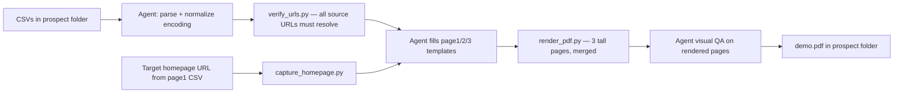

# Design: `demo-pdf` skill — prospect demo PDF generator

**Date:** 2026-07-21
**Status:** Approved
**Source brief:** `demo_pdf/example-prospect/overview.md`

## Purpose

A project skill that lets an AI agent turn a prospect folder (three CSVs + a target
homepage URL) into a 3-page static sales PDF simulating the Visitor Intelligence
widget installed on the prospect's site. The story the PDF tells: surfacing scattered
content and showing visitor intent. It never writes new posts, never shows a draft
scaffold, "Write it for me," or a credits meter.

The first run against `demo_pdf/example-prospect/` is the skill's acceptance
test (Jane / Example Blog). After that it is applied to real prospects.

## Decisions made during brainstorming

| Decision | Choice |
| --- | --- |
| Sequencing | Build the skill first; the example PDF is its acceptance test |
| Rendering pipeline | Standalone HTML templates + Playwright (no dependency on the running Next.js app) |
| Page geometry | Letter-width (8.5 in), content-height "tall" pages; one PDF, three pages |
| Skill shape | Helper scripts for deterministic steps + agent judgment for content fitting and QA |
| "Strip:" lists in overview.md | Elements to REMOVE from the dashboard layouts (confirmed by user) |
| Palette | The warm print palette from `demo_pdf/example-prospect/page3_wireframe.html`, shared across all three pages |

## Skill anatomy

```
.claude/skills/demo-pdf/
├── SKILL.md                  # process, guardrails, QA checklist
├── templates/
│   ├── tokens.css            # shared palette lifted from page3_wireframe.html
│   ├── page1.html            # screenshot hero + widget overlay + 3 lead rows
│   ├── page2.html            # intent-clusters layout (mirrors intent-explorer.tsx)
│   └── page3.html            # content-gaps layout (page3_wireframe.html, parameterized)
└── scripts/
    ├── capture_homepage.py   # Playwright screenshot of target homepage, cookie-banner dismissal
    ├── verify_urls.py        # HTTP-checks every source URL; hard-fails on any miss
    └── render_pdf.py         # per page: measure content height → print 8.5in × auto → merge into one PDF
```

**Invocation:** agent invokes the skill with a prospect folder path and an author
name, e.g. `/demo-pdf demo_pdf/example-prospect --author Jane`. The author
name drives the "Ask {author}" widget branding; it is intentionally not in the CSVs.

## Pipeline



Scripts own the deterministic steps (screenshot, URL verification, print, merge).
The agent owns judgment: reading the CSVs, filling templates, truncating the
in-widget answer preview naturally, and a visual QA pass (screenshot each rendered
page and check for overflow, clipping, broken layout, label mismatches).

## Inputs

Per prospect folder:

- `page1_leads.csv` — 3 rows: `cluster_name`, `lead_order`, `question`,
  `answer_text` (long, with `[Cite](url)` links), `source_post_urls`,
  `target_homepage_url`
- `page2_clusters.csv` — 5 rows: `cluster_name`, `is_featured`, `nav_order`,
  `question_1..3`, `source_post_titles`, `source_post_urls`
- `page3_scattered_content_gaps.csv` — rows keyed by `gap_id`: `gap_title`,
  `reader_questions` (pipe-separated), per-post `source_post_title/url/coverage`,
  `bridge_line`. Only the gap flagged for this prospect renders (example: faux stone);
  other gaps are seed examples for the skill to learn from.
- Skill argument: author name (widget branding). Optional: accent color.

## The three pages

All pages: Letter width (8.5 in), height as tall as content requires, shared
`tokens.css` palette so the PDF reads as one coherent artifact.

### Page 1 — Surfaced answer

- Hero: full-width screenshot of the prospect homepage (from
  `target_homepage_url`) with the widget panel overlaid bottom-right. The panel
  matches the look of `components/widget/visitor-widget.tsx` ("Ask {author}"
  header, visitor bubble, author answer) and shows lead #1's question plus the
  top of its answer, cropped realistically at the panel edge.
- Below the hero: 3 lead rows. Each row: cluster chip (verbatim
  `cluster_name`), the reader question, and the FULL cited answer with cite
  links styled as in the widget. No truncation in the rows.
- Page 1 leads = 3, not 5 (decided in the brief).

### Page 2 — Intent clusters

- Two-column layout mirroring `components/dashboard/intent-explorer.tsx`: left
  column lists the 5 cluster labels in `nav_order` (featured cluster
  highlighted, other four label-only); right column is the featured cluster's
  detail: 3 reader questions + source posts.
- Featured cluster = "Favorite painting products" (decided in the brief; comes
  from `is_featured` in the CSV).
- Every volume and trend number renders as literal `X` or `XX%`. The skill
  never invents numbers.
- Removed (per "Strip:"): top 4 stat boxes, bottom "Intent by [type]" section,
  app left navigation.

### Page 3 — Content gaps (scattered content)

- Exactly the layout of `demo_pdf/example-prospect/page3_wireframe.html`,
  parameterized from the CSV: single featured gap card with numbered badge,
  gap title, meta line "Recurring reader interest · touched in N of your posts"
  (N = count of source posts; no other counts), "What readers actually asked"
  question list, "Where the answer lives across your posts" post list with
  plain-text `Covers: …` coverage lines (no percentage bars), bridge line
  closes the card, no CTA.
- Removed (per "Strip:"): top 4 summary boxes, Draft scaffold column, "Choose
  your output" section, Scaffold and Full article panels, "Send to draft" and
  "Write it for me" CTAs, trend badges, "New" pills.

## Guardrails (encoded in SKILL.md)

1. **Verbatim labels.** Every cluster label renders exactly as the CSV's
   `cluster_name` (`expected_consolidation_group` values). Before finishing, the
   agent diffs every rendered label against the CSV.
2. **No fabricated URLs.** `verify_urls.py` requests every source URL and
   hard-fails the run on any non-success response. Nothing unverified ships.
3. **Encoding tolerance.** The example CSVs contain mixed UTF-8/cp1252 bytes. The
   skill reads tolerantly and normalizes to clean UTF-8 (smart quotes,
   em-dashes repaired) before rendering.
4. **Masked numbers.** Page 2 volumes/trends are always `X` / `XX%`.
5. **Drafted questions stay as given.** Some Page 3 reader questions are drafted
   rather than from the batch (flagged in CSV notes); render them as-is, never
   "improve" them.
6. **Story discipline.** No affiliate chip, no draft scaffold, no "Write it for
   me," no credits meter, no live widget install.

## Error handling

- Homepage screenshot fails (timeout, bot-block): agent retries with longer
  timeout and scroll-settle; if still failing, stop and report — no stock or
  fabricated background.
- URL verification failure: stop and report the failing URLs — never render with
  broken citations.
- Content overflow (answer longer than expected): pages are content-height, so
  overflow is absorbed by design; QA pass still checks for clipping and layout
  breaks.
- Malformed CSV (missing columns, wrong row counts): stop and report; do not
  guess values.

## Testing / acceptance

The skill is complete when a run against `demo_pdf/example-prospect/` with
author "Jane" produces `demo.pdf` in that folder satisfying:

- Page 1: example homepage background, widget overlay showing lead #1, 3 lead rows
  with full cited answers, cluster chips verbatim.
- Page 2: 5 clusters in the left column, "Favorite painting products" featured
  with its 3 questions and 3 source posts, all numbers masked.
- Page 3: faux-stone gap card only, matching the approved wireframe.
- All source URLs verified live; every rendered label matches its CSV value.
- Visual QA pass shows no clipping, overflow, or broken layout on any page.

## Out of scope (this iteration)

- Affiliate chip on the Page 1 widget answer
- Live widget install on any prospect site
- Rating stability re-check (deferred until there is a customer)
- Automation of CSV creation (crawl/content analysis happens upstream)
